<div align="center">

# 开源项目照相馆

**Open Source Photo Studio**

把开源项目，拍成一张能发出去的图

[](https://iiiiiiiiiiiiiKK.github.io/open-source-photo-studio/)
[](https://github.com/iiiiiiiiiiiiiKK/open-source-photo-studio)
[](https://x.com/0xkillcoin)
[](LICENSE)

输入一个 GitHub 仓库地址，自动读取真实元信息、生成中文介绍与亮点，套用六种版式，导出 16:9 / 1:1 / 3:4 的高清 PNG。

**不是演示壳子**：元信息来自真实的 GitHub REST API，截图来自服务端真实无头浏览器，文案的每条亮点都标注了出处，导出的是可以直接发出去的 PNG 文件。

</div>

---

<div align="center">

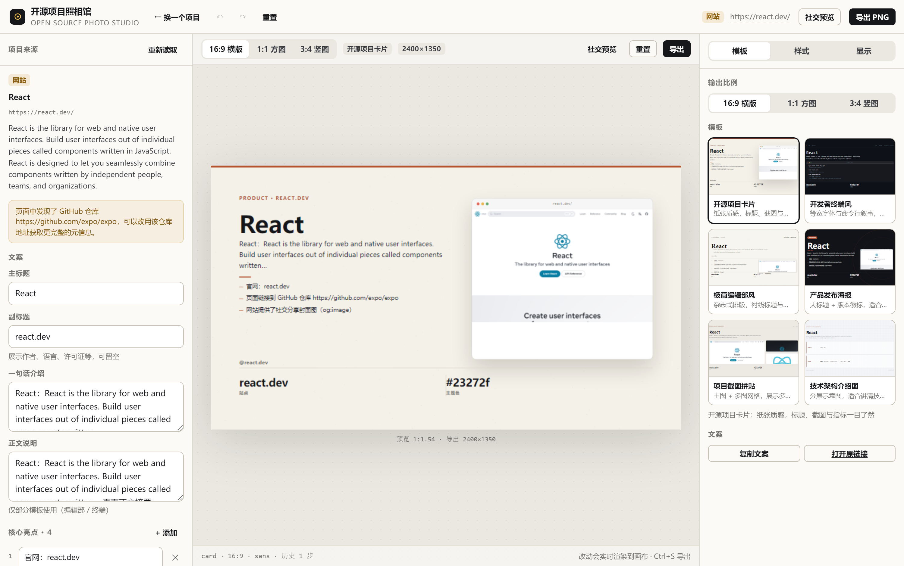

<sub>桌面端：左侧写文案 · 中间画布 · 右侧选模板与样式</sub>

</div>

---

## 目录

- [它解决什么问题](#它解决什么问题)
- [效果预览](#效果预览)
- [快速开始](#快速开始)
- [两种运行模式](#两种运行模式)
- [六种模板](#六种模板)
- [内容生成规则](#内容生成规则为什么不编数据)
- [编辑能力](#编辑能力)
- [技术架构](#技术架构)
- [安全性](#安全性)
- [API 参考](#api-参考)
- [部署](#部署)
- [测试与验收](#测试与验收)
- [项目结构](#项目结构)
- [已知限制](#已知限制)
- [支持作者](#支持作者)

---

## 它解决什么问题

开源作者经常需要一张「能发出去」的项目图：

- GitHub 的自动社交卡片 **不能改文案**，也不能选比例；
- 在设计工具里手动排版一次要 **半小时**，改个标题又要重来；
- 不同平台尺寸要求不同（README 头图 / 信息流 / 小红书），每次都要 **重做一遍**；
- 项目 Star 数、语言构成这些数据 **手抄容易出错**，时间一长还会过期。

这个工具把这件事压缩成三步：**粘链接 → 选模板 → 导出**。

| 痛点 | 这里的做法 |
| --- | --- |
| 元信息要手抄 | 直接读 GitHub REST API，Star / Fork / 语言构成 / 许可证 / README 全部自动带入 |
| 没有配图 | 服务端用本机 Chrome 真实截图页面；也能自动取 README 里的项目截图 |
| 文案写得空洞 | 规则引擎只陈述可核验的事实，每条亮点都带 `evidence` 出处 |
| 排版要反复调 | 预览与导出共用同一个 Canvas 渲染器，所见即所得 |
| 换比例要重做 | 三种比例各有独立排版分支，不是把 16:9 硬拉成竖版 |

---

## 效果预览

### 一次输入，三种比例

<table>
<tr>
<td width="50%">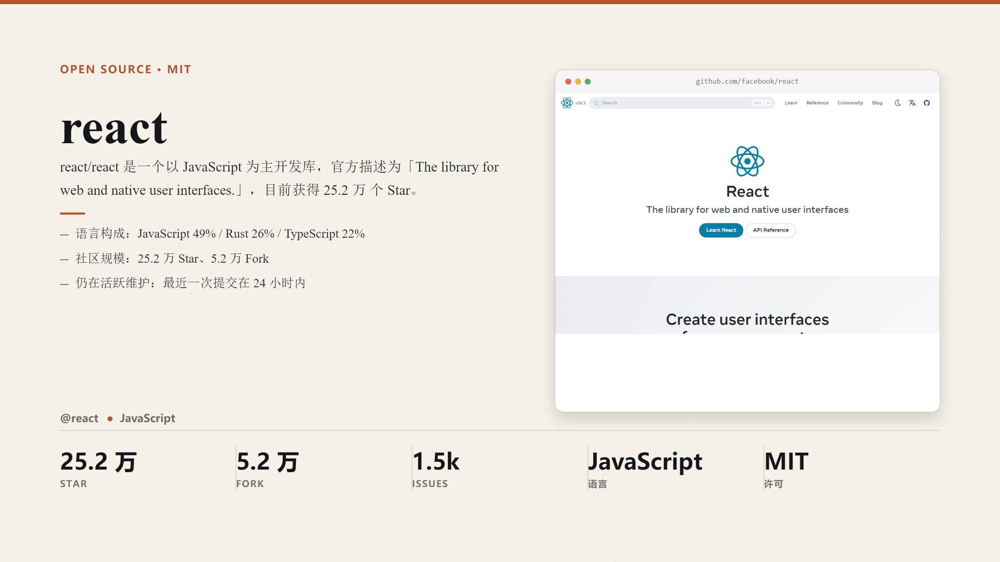<br><sub><b>16:9 · 2400×1350</b> — 社交卡片、README 头图</sub></td>
<td width="50%">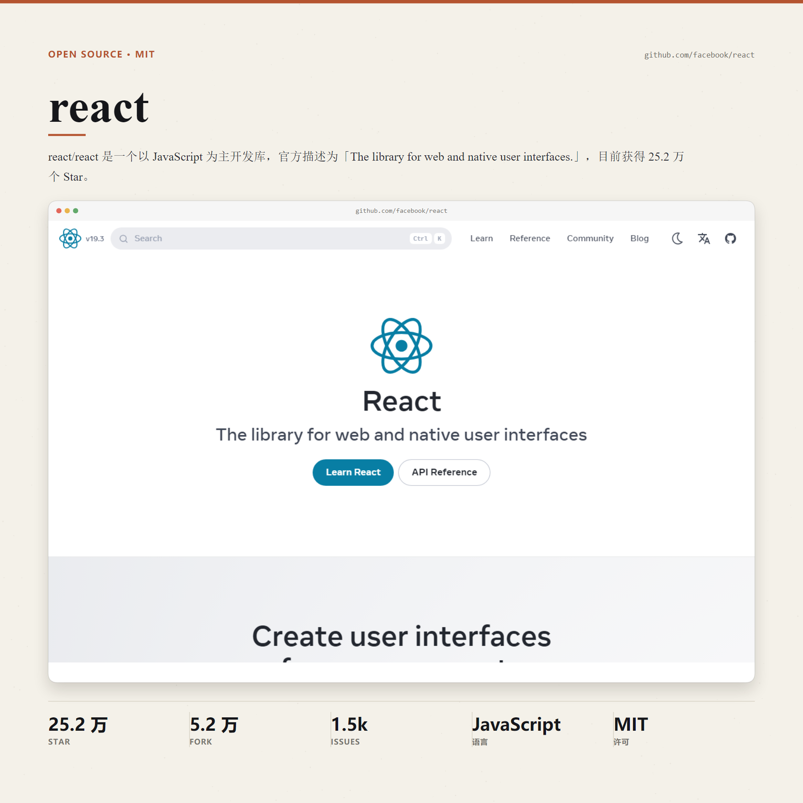<br><sub><b>1:1 · 1800×1800</b> — 信息流、九宫格</sub></td>
</tr>
<tr>
<td colspan="2" align="center">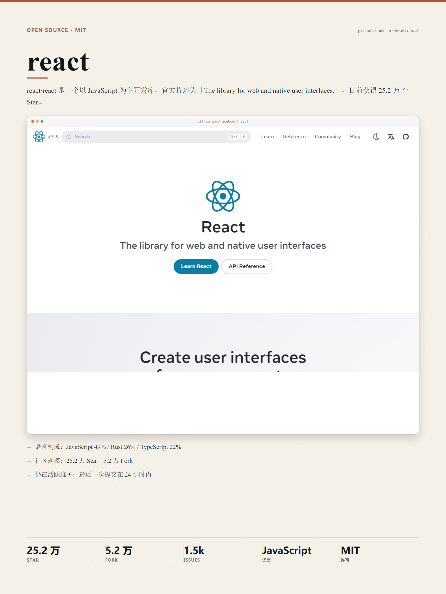<br><sub><b>3:4 · 1800×2400</b> — 小红书、竖版海报</sub></td>
</tr>
</table>

### 手机端是分步骤编辑，不是把三栏挤进窄屏

<div align="center">
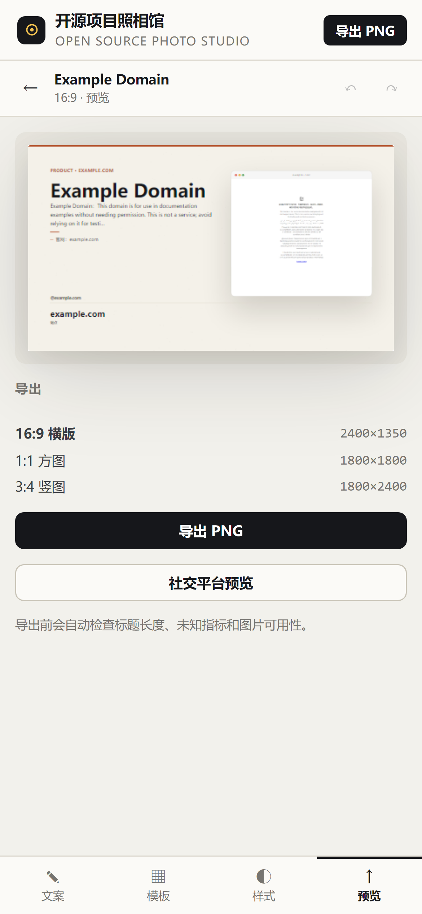
</div>

---

## 快速开始

### 环境要求

- Node.js ≥ 20（用 22 验证）
- 本机已安装 Chrome / Edge / Chromium 之一（用于真实截图；没有也能用，只是截图会自动置灰）
- **不需要任何 API Key**

### 安装与运行

```bash
git clone https://github.com/iiiiiiiiiiiiiKK/open-source-photo-studio.git
cd open-source-photo-studio
npm install

# 开发模式：API(8931) + 前端(5199) 一起启动
npm run dev
# 打开 http://localhost:5199
```

生产模式（单端口，前后端同源）：

```bash
npm run build     # 构建前端到 dist/
npm start         # 静态站点 + API 都跑在 8931
# 打开 http://localhost:8931
```

只跑其中一个：

```bash
npm run dev:api   # 只启 API
npm run dev:web   # 只启前端（需 API 已在 8931）
```

### 配置环境变量（全部可选）

```bash
cp .env.example .env
```

| 变量 | 默认值 | 说明 |
| --- | --- | --- |
| `PORT` | `8931` | API / 站点端口 |
| `GITHUB_TOKEN` | 空 | 填入后 GitHub 配额从 60/小时 提升到 5000/小时（只需 `public_repo` 权限） |
| `CHROME_PATH` | 自动探测 | 浏览器可执行文件路径 |
| `SHOT_TIMEOUT_MS` | `25000` | 单次导航超时 |
| `SHOT_MAX_HEIGHT` | `3200` | 长截图最大高度，防内存爆炸 |
| `SHOT_CONCURRENCY` | `2` | 并发截图数 |
| `AI_API_KEY` | 空 | 留空即「无 AI 模式」，文案由规则引擎生成，导出功能完全不受影响 |
| `AI_BASE_URL` | `https://api.openai.com/v1` | 任意 OpenAI 兼容接口（DeepSeek / Moonshot / 本地 vLLM 都行） |
| `AI_MODEL` | `gpt-4o-mini` | 模型名 |

---

## 两种运行模式

同一份代码支持两种部署形态，UI 会自动探测并明确告知当前能力边界 —— **不做静默降级**。

| 能力 | 服务端模式（Node / Docker） | 静态模式（GitHub Pages） |
| --- | --- | --- |
| GitHub 元信息（Star/Fork/语言/许可证/README） | ✅ | ✅ |
| README 配图读取 | ✅ | ✅（仅返回 CORS 头的图床） |
| 任意网站 meta 抓取 | ✅ | ❌ 浏览器跨域限制 |
| 真实网页截图 | ✅ 无头浏览器 | ❌ 无法启动浏览器 |
| 远程图片代理（绕过跨域） | ✅ `/api/image` | ❌ |
| 六模板 × 三比例排版导出 | ✅ | ✅ |
| 手动填写项目信息 | ✅ | ✅ |
| 上传本地图片 | ✅ | ✅ |

静态模式启动时会在首页显示「静态版」标记和可用能力说明，被限制的功能会给出替代路径（换 GitHub 地址 / 手动填写 / 本地跑服务端），不会假装成功。

---

## 六种模板

<div align="center">

| 模板 | 预览 |
| --- | --- |
| **开源项目卡片**<br><sub>米色纸感、左文右图、底部指标条</sub> | 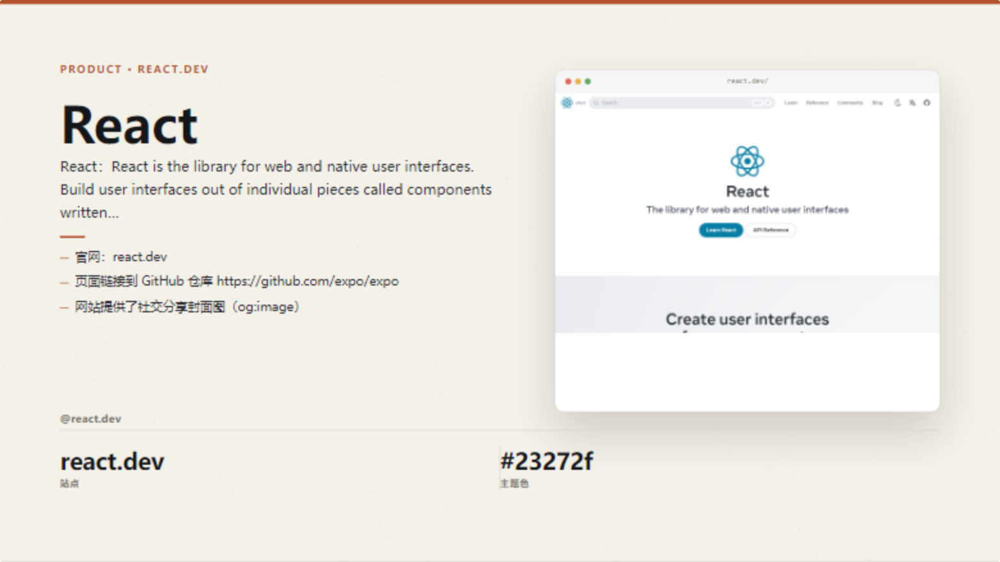 |
| **开发者终端风**<br><sub>等宽字体、命令行叙事、荧光绿强调</sub> | 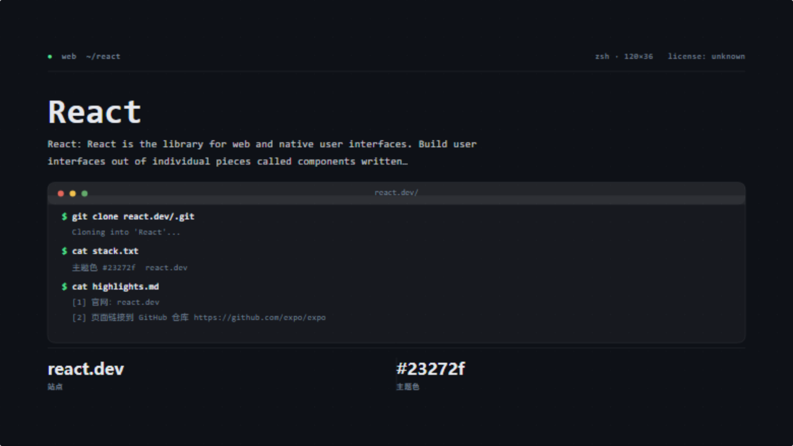 |
| **极简编辑部风**<br><sub>衬线大标题、编号小节、大量留白</sub> | 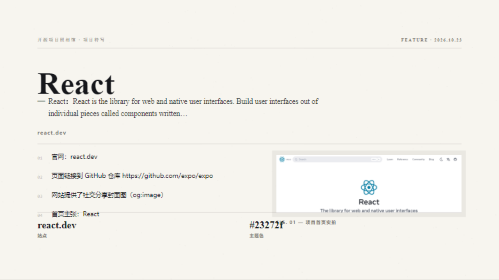 |
| **产品发布海报**<br><sub>超大标题、版本徽标、圆形装饰</sub> | 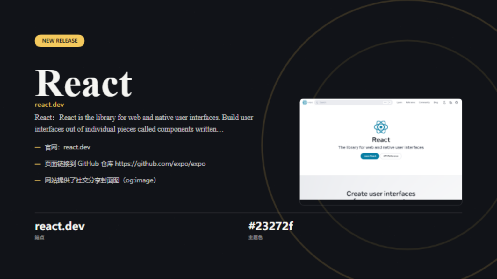 |
| **项目截图拼贴**<br><sub>主图 + 小图网格</sub> | 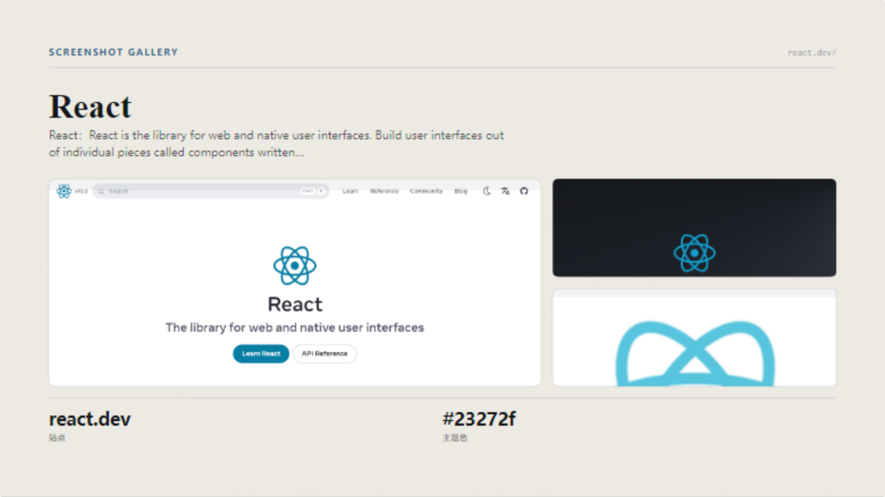 |
| **技术架构介绍图**<br><sub>分层底板 + 技术栈胶囊</sub> | 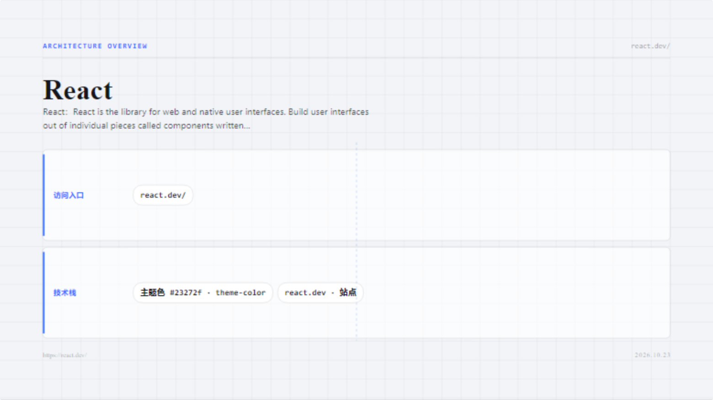 |

</div>

所有模板都会：

- **缺图不空框** —— 没有截图时自动切换成数据面板（语言构成 / 亮点 / 标签）。
- **长标题不溢出** —— 自动降字号 + 中英混排断行（中文按字断、英文按词断、标点不落行首）。
- **缺数据不编造** —— 未获取到的指标显示「未知」并弱化，而不是塞一个假数字。

---

## 内容生成规则（为什么不编数据）

服务端把「抓到的原始资料」和「生成的文案」严格分开存放：

```jsonc
{
  "project": { /* 原始资料，来自 API / HTML，未经改写 */ },
  "copy": {
    "facts": [
      { "label": "官方简述", "value": "...", "source": "GitHub REST API description" }
    ],
    "highlights": [
      { "text": "语言构成：TypeScript 84% / JavaScript 9%", "evidence": "GitHub REST API /languages" }
    ],
    "metrics": [
      { "key": "stars",  "value": "8.3 万", "known": true,  "source": "stargazers_count" },
      { "key": "issues", "value": "未知",    "known": false, "source": "open_issues_count" }
    ]
  }
}
```

规则引擎的做法是「只陈述能验证的事」：

- 有描述才写描述，没有就写「仓库没有填写简述」；
- 有语言构成才写百分比，没有就跳过；
- 亮点优先取 README 中 Features / 特性 小节的条目（项目自己宣称的），不够时补充语言构成、Star 规模、最近提交时间、最新版本、Topics、许可证等你可核对的字段；
- 仓库超过 45 天没提交，不会硬写「活跃维护」；
- 归档仓库会明确提示「已被作者归档」。

### 使用 AI 时（可选）

同样先把事实材料作为 JSON 传进去，system prompt 里写死：

> 1. 只能使用用户提供的事实材料，绝不编造 Star 数、作者、功能、性能数字或用户评价。
> 2. 材料里没有的信息必须省略，或写「未公开」，不要用推测填补。
> 3. 中文表达自然、具体，避免空洞的营销词。

AI 调用失败会自动回退到规则文案，并在界面上说明原因 —— **AI 是润色，不是必需链路**。

---

## 编辑能力

| 分类 | 可调项 |
| --- | --- |
| 文案 | 主标题、副标题、一句话介绍、正文、最多 5 条亮点、徽标文案、页脚 |
| 视觉 | 强调色（8 个预设 + 取色器 + HEX 输入）、背景色（8 个预设 + 自定义）、字体（无衬线 / 衬线 / 等宽 / 圆体）、标题字号 70–125%、纸张颗粒强度 0–100% |
| 图片 | 缩放 0.6–3×、水平位移、垂直位移、三种裁切方式（顶部铺满 / 居中填满 / 完整显示）、支持上传本地图片 |
| 指标 | 逐项开关；未获取到的标记「未知」 |
| 布局 | 三种比例切换、模板切换（沿用文案，套用新模板配色） |

其他细节：

- **撤销 / 重做**：`Ctrl/Cmd + Z`、`Ctrl/Cmd + Shift + Z`，滑杆连续拖动会合并成一次历史。
- **社交预览**：模拟 X 信息流和中文社交卡片的实际观感，附 X 短文案一键复制。
- **导出前检查**：标题长度、亮点数量、未知指标、图片来源、仓库活跃度，逐条给出提示。
- **一键复制**：项目文案 + 原始链接。

---

## 技术架构

```
┌──────────────────────────── 浏览器 ────────────────────────────┐
│  React 18 + TypeScript + Vite（零 UI 框架，产物 gzip ≈ 88 KB）  │
│                                                                │
│   Workbench（三栏）         Canvas 渲染引擎（手写 2D）           │
│   ├─ LeftPanel  文案/素材    ├─ text.ts       中英混排断行       │
│   ├─ Stage      画布        ├─ primitives.ts 纸纹/胶囊/指标条    │
│   └─ RightPanel 模板/样式    ├─ templates/   六套版式            │
│                             └─ renderDesign  预览=导出同一条路   │
│                                                                │
│   移动端 MobileStudio（分步骤，四 Tab）                          │
└───────────────┬────────────────────────────────┬───────────────┘
                │ /api/*（服务端模式）             │ 直连 GitHub API（静态模式）
┌───────────────▼──────────────────┐    ┌────────▼─────────────┐
│  Node API（Express）              │    │  api.github.com      │
│  ├─ url-guard    SSRF 三道闸      │    │  （CORS: *）          │
│  ├─ http.mjs     钉 IP 的安全客户端│    └──────────────────────┘
│  ├─ github.mjs   REST + README    │
│  ├─ site.mjs     OG / JSON-LD     │
│  ├─ screenshot   Playwright 截图   │
│  ├─ copywriter   规则文案 + 可选 AI │
│  └─ limiter      截图并发信号量     │
└───────────────┬──────────────────┘
                │
       本机 Chrome（无头）
```

**为什么用原生 Canvas 而不用 fabric / konva？**

模板排版是强约束的固定版式，手写绘制比通用画布引擎更可控 —— 尤其是「长标题自动降字号」「中文按字断行、英文按词断行、标点不落行首」这类细节，用通用引擎反而要写更多补丁。

**为什么用 `playwright-core` 而不是 `playwright`？**

`playwright-core` 不下载浏览器，直接驱动系统里已安装的 Chrome / Edge。镜像更小，浏览器版本由你掌控，也避免了 CI 里 300MB 的下载。

---

## 安全性

### SSRF 防护（三道闸 + 一道兜底）

所有出站请求（元信息抓取、图片代理、网页截图）都必须经过 `server/lib/url-guard.mjs`：

**第一道：协议白名单**
只允许 `http:` / `https:`。`file:`、`ftp:`、`gopher:`、`data:` 等一律拒绝，带用户名密码的 URL 也拒绝。

**第二道：主机名黑名单**
`localhost`、`*.localhost`、`*.local`、`*.internal`、`*.intranet`、`*.corp`、`*.home`、`*.lan`、`metadata.google.internal`、`instance-data` 等。

**第三道：IP 段校验（解析所有 A/AAAA 记录后逐个检查）**

| 类型 | 禁止的地址段 |
| --- | --- |
| IPv4 | `0.0.0.0/8`、`10/8`、`100.64/10`、`127/8`、`169.254/16`（含云元数据 `169.254.169.254`）、`172.16/12`、`192.0.0/24`、`192.0.2/24`、`192.168/16`、`198.18/15`、`198.51.100/24`、`203.0.113/24`、`224/4`、`240/4` |
| IPv6 | `::`、`::1`、`fc00::/7`、`fe80::/10`、`fec0::/10`、`ff00::/8`、`2001:db8::/32`、`0100::/64`、`2002::/16`、`64:ff9b::/96`、IPv4 映射地址（`::ffff:127.0.0.1` 会还原成 IPv4 再校验） |

**兜底：防 DNS rebinding**
解析出 IP 后，HTTP 请求把连接目标**钉死**在这个已验证的 IP 上（自定义 `lookup`），避免「解析时是公网、连接时变内网」。

**跳转逐跳校验**
重定向不交给底层库自动跟随，而是手动循环，每一跳都重新走一遍协议 + 主机 + IP 校验，最多 4 跳。

**截图进程内二次拦截**
Playwright 通过 `context.route('**/*')` 拦截页面每个子请求（图片、字体、XHR、iframe），异步解析主机名并查 IP，命中内网直接 `abort`。WebSocket / media / manifest 资源类型直接禁止，弹窗一律关闭，跳转后的最终 URL 再校验一次。

### 其他加固

| 项目 | 措施 |
| --- | --- |
| 响应大小 | 元信息 4–6 MB、图片 12 MB、截图 12 MB 上限 |
| 超时 | 导航 25s、整体预算 45s、排队 25s |
| 并发 | 截图信号量默认 2，队列过长直接拒绝 |
| 限流 | 按「路由 + IP」分桶的令牌桶，图片代理单独一桶，不影响截图配额 |
| 任意脚本 | 服务端不执行用户提交的任何代码；页面 JS 只在浏览器沙箱内运行，只截图不取数据 |
| SVG | 图片代理直接拒绝（可能内嵌脚本） |
| 响应头 | `X-Content-Type-Options`、`Referrer-Policy`、`X-Frame-Options`、CSP |
| 出站 UA | 如实声明 `OpenSourcePhotoStudio/1.0`，不伪装成普通用户 |

### 无障碍

语义化标签（`aside` / `main` / `header` / `nav`）、`role="switch"` + `aria-checked`、图标按钮带 `aria-label`、触控目标 ≥ 36px、正文对比度约 15:1、全部交互可键盘操作。

---

## API 参考

所有接口在 `/api` 下，返回 JSON（截图接口返回 PNG）。

<details>
<summary><b><code>GET /api/health</code></b> — 服务与能力探测</summary>

```json
{
  "ok": true,
  "version": "1.0.0",
  "screenshot": { "available": true, "executablePath": "C:\\...\\chrome.exe", "limits": { "timeoutMs": 25000, "maxHeight": 3200, "maxConcurrent": 2 } },
  "ai": { "enabled": false, "model": null },
  "githubToken": false,
  "viewports": [{ "key": "desktop-1280", "label": "桌面 1280×800", "width": 1280, "height": 800 }]
}
```

</details>

<details>
<summary><b><code>POST /api/extract</code></b> — 抓取 + 生成文案</summary>

请求：

```json
{ "url": "https://github.com/facebook/react", "withScreenshot": true, "viewport": "desktop-1280", "ai": false }
```

响应：`{ ok, elapsedMs, project, copy, screenshots, shot, warnings, ai, screenshotCapability }`

- `project` —— 原始元信息
- `copy` —— 生成文案（含 `facts` 与 `highlights[].evidence` 供核对）
- `shot` —— 截图元信息（`url` 指向 `/api/screenshot/:id`）
- `warnings` —— 抓取过程中的降级提示

</details>

<details>
<summary><b><code>POST /api/screenshot</code></b> — 单独截图</summary>

```json
{ "url": "https://example.com", "viewport": "desktop-1280", "fullPage": false }
```

返回 `{ ok, id, width, height, finalUrl, title, blocked, partial, url }`。

</details>

<details>
<summary><b><code>GET /api/screenshot/:id</code></b> — 取截图 PNG</summary>

返回 `image/png`，内存缓存 30 分钟。

</details>

<details>
<summary><b><code>GET /api/image?url=&lt;encoded&gt;</code></b> — 图片代理</summary>

只允许 `image/*`（拒绝 SVG），限制 12 MB，带 1 小时缓存。前端画布通过它加载远程图片，避免 canvas 跨域污染导致无法导出。

</details>

<details>
<summary><b><code>POST /api/copy</code></b> — 重新生成文案</summary>

用已抓取的 `project` 重新生成文案，不重新抓网络。

</details>

<details>
<summary><b><code>POST /api/manual</code></b> — 手动模式（不出网）</summary>

`{ name, description, url, owner, tags }` → `{ project, copy }`

</details>

### 错误格式

```json
{ "error": "IP_BLOCKED", "message": "禁止访问的 IP 地址（内网 10.0.0.0/8）", "hint": "只允许访问公网 http/https 地址。" }
```

常见错误码：`URL_INVALID`、`PROTOCOL_BLOCKED`、`HOST_BLOCKED`、`IP_BLOCKED`、`REPO_NOT_FOUND`、`RATE_LIMIT`、`SHOT_TIMEOUT`、`NO_BROWSER`、`SSRF_BLOCKED`、`REDIRECT_BLOCKED`、`RATE_LIMITED`、`SHOT_EXPIRED`、`STATIC_LIMIT_SITE`。

---

## 部署

### 方式一：GitHub Pages（静态版，已内置工作流）

仓库自带 `.github/workflows/deploy-pages.yml`，推到 `main` 即自动构建并发布：

1. 仓库 **Settings → Pages → Build and deployment → Source** 选择 **GitHub Actions**
2. 推送到 `main`，等待 Actions 完成
3. 访问 `https://<username>.github.io/<repo-name>/`

> ⚠️ 静态版无法截图（浏览器沙箱里没有无头浏览器），也无法抓任意网站的 meta。需要这些能力请用下面的服务端部署。

本地手动构建静态版：

```bash
STATIC=1 BASE=/open-source-photo-studio/ npm run build
# 产物在 dist-static/
```

### 方式二：Docker（推荐，能力完整）

```bash
docker compose up -d --build
# 打开 http://localhost:8931
```

镜像基于 `node:22-bookworm-slim`，安装 `chromium` + `fonts-noto-cjk`（没装中文字体，图里的中文会变成方块）。容器以非 root 用户运行，带 healthcheck。

### 方式三：直接部署到已有 Node 环境

```bash
npm ci --omit=dev
npm run build
PORT=8931 HOST=0.0.0.0 CHROME_PATH=/usr/bin/chromium node server/index.mjs
```

systemd 示例：

```ini
[Unit]
Description=Open Source Photo Studio
After=network.target

[Service]
WorkingDirectory=/opt/photo-studio
Environment=NODE_ENV=production PORT=8931 HOST=127.0.0.1
Environment=CHROME_PATH=/usr/bin/chromium
ExecStart=/usr/bin/node server/index.mjs
Restart=always
User=photostudio
MemoryMax=1G

[Install]
WantedBy=multi-user.target
```

### 方式四：前后端分离（静态托管 + 独立 API）

前端是纯静态产物，可以扔到 Cloudflare Pages / Vercel / Nginx；API 单独跑一台带 Chrome 的机器，反代 `/api`：

```nginx
location /api/ {
    proxy_pass http://127.0.0.1:8931;
    proxy_set_header X-Forwarded-For $proxy_add_x_forwarded_for;
    proxy_read_timeout 120s;      # 截图可能比较慢
    client_max_body_size 1m;
}
```

### 部署检查清单

- [ ] `GET /api/health` 里 `screenshot.available` 为 `true`
- [ ] 配置了 `GITHUB_TOKEN`（避免 60 次/小时配额成为瓶颈）
- [ ] 容器 / 主机内存 ≥ 1 GB（Chromium 单实例约 200–400 MB）
- [ ] 反代 `proxy_read_timeout` ≥ 90s
- [ ] 生产环境用 HTTPS（否则 `navigator.clipboard` 会失效，会回退到 execCommand）

---

## 测试与验收

```bash
npm run build          # tsc -b + vite build，必须通过
npm run typecheck      # 纯类型检查

# 以下需要服务已启动（npm start 或 npm run dev:api）
npm run test:api       # 元信息 / 文案 / 截图 / 手动模式 / 异常输入
npm run test:ssrf      # SSRF 与安全边界（43 项）
npm run test:export    # 真实浏览器跑完整流程并校验导出 PNG
npm run test:mobile    # 移动端分步布局与横向溢出
npm run test:layout    # 6 模板 × 3 比例的版面溢出审计
```

辅助脚本（人工核对用）：

```bash
node scripts/inspect-png.mjs <file.png>   # PNG → ASCII 预览
node scripts/png-regions.mjs <file.png>   # 网格化墨量统计，找大片空白
node scripts/shot-quality.mjs <file.png>  # 判断截图是否白屏
node scripts/sample-canvas.mjs <url>      # 画布取样 + 素材尺寸
node scripts/grab-canvas.mjs <url>        # 直接抓取预览画布
```

### 实测记录

| 验收项 | 方法 | 结果 |
| --- | --- | --- |
| 真实仓库元信息正确 | 抓 `facebook/react` | ✅ Star 251,708、JavaScript、MIT、7 种语言构成、README 5,296 字符，均与 GitHub 页面一致 |
| 页面截图真实有效 | PNG 头 + 亮度/颜色分布分析 | ✅ 1280×800、128 KB；`react.dev` 截图经分析确认为真实页面而非白屏 |
| 三种比例都能导出 | 真实浏览器点击导出 | ✅ 2400×1350 / 1800×1800 / 1800×2400，PNG 头校验通过 |
| 长标题 / 中文 / 缺图 / 异常 URL | 自动化 + 截图检查 | ✅ 超长中文标题自动降字号断行；空介绍不崩；无图切数据面板；空串 / 非法串 / `ftp://` / 不存在的仓库均有中文错误提示 |
| 无 API Key 仍可制作并导出 | 全程未配置 Key | ✅ 文案模式为 `deterministic`，导出正常 |
| 无法访问内网与本地资源 | 43 项 SSRF 断言 | ✅ 全部拦截（含跳转到元数据地址） |
| 版面不溢出 | 18 种组合审计 | ✅ 全部文字在安全边距内 |
| 移动端不是三栏硬挤 | 390×844 视口 | ✅ 三栏隐藏，改为四步 Tab，横向溢出 0px |

---

## 项目结构

```
open-source-photo-studio/
├── shared/                      # 服务端与浏览器共用（纯 JS，两端都能跑）
│   ├── copywriter.mjs           # 规则文案引擎 + 可选 AI
│   └── github-parse.mjs         # GitHub 网址解析 / README 处理 / 项目结构组装
├── server/                      # 轻量 Node API
│   ├── index.mjs                # 路由、限流、缓存、静态托管
│   └── lib/
│       ├── url-guard.mjs        # SSRF 防护
│       ├── http.mjs             # 安全 HTTP 客户端（钉 IP / 限跳转 / 限大小）
│       ├── github.mjs           # GitHub REST 抓取
│       ├── site.mjs             # 网页元信息（OG / favicon / JSON-LD）
│       ├── screenshot.mjs       # Playwright 截图 + CDP 层请求拦截
│       └── limiter.mjs          # 截图并发信号量
├── src/
│   ├── render/                  # Canvas 渲染引擎
│   │   ├── text.ts              # 中英混排断行、自适应字号、字距
│   │   ├── primitives.ts        # 纸纹、圆角、胶囊、指标条、浏览器外框
│   │   ├── geometry.ts          # 三种比例的设计坐标与导出倍率
│   │   ├── assets.ts            # 图片加载（代理 / CORS）与裁切绘制
│   │   ├── renderDesign.ts      # 渲染入口（预览与导出共用）
│   │   └── templates/           # 六套模板 + 共享排版工具
│   ├── components/              # 左栏 / 右栏 / 画布 / 导出弹窗 / 移动端
│   ├── hooks/                   # useHistory（撤销栈）、usePreviewCanvas
│   ├── lib/                     # API 门面、静态模式、工具函数
│   ├── state/design.ts          # 设计稿初始态、模板切换、配色预设
│   ├── types.ts
│   └── styles.css               # 设计系统（CSS 变量，无 UI 框架）
├── scripts/                     # 测试与审计脚本
├── docs/assets/                 # README 用图
├── .github/workflows/           # GitHub Pages 自动部署
├── Dockerfile / docker-compose.yml / .env.example
└── README.md
```

---

## 已知限制

- **网络环境**：如果服务器无法访问 `github.com`，GitHub 仓库地址会抓取失败（`api.github.com` 通常更容易访问）。可以改用项目官网地址或手动模式。
- **单页应用**：截图能拿到首屏，依赖滚动触发且耗时超预算的内容可能缺失。这是截图而不是爬虫，不保证抓到动态渲染的全部内容。
- **登录墙**：不登录、不绕过付费墙、不破解访问控制。需要登录才能看的内容抓不到，这是设计约束而非缺陷。
- **静态版**：无法截图、无法抓任意网站 meta（浏览器跨域限制），README 图片只支持返回 CORS 头的图床。
- **字体**：使用系统字体（PingFang / 微软雅黑 / Noto Sans SC / Songti）。不同系统字形略有差异，Linux 容器内已装 Noto CJK。
- **缓存**：截图与元信息缓存在进程内存里，重启即失效，多实例不共享。

---

## 支持作者

如果这个工具帮你省下了排版时间，可以请我喝杯咖啡 ☕

<div align="center">

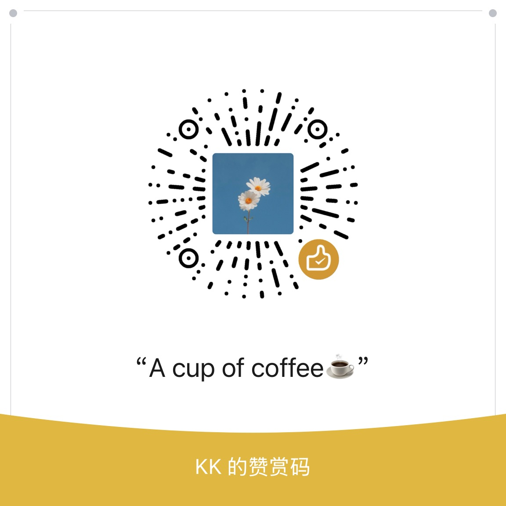

<br><br>

**联系与反馈**

[](https://x.com/0xkillcoin)
[](https://github.com/iiiiiiiiiiiiiKK/open-source-photo-studio/issues)

</div>

---

## 许可与合规

- 本项目代码以 [MIT 许可证](LICENSE) 发布。
- 抓取的仓库元信息来自 GitHub 公开 API，遵循其[服务条款](https://docs.github.com/en/site-policy/github-terms/github-terms-of-service)。
- 截图与 README 图片的版权归原项目作者所有。生成图用于介绍该项目时，请保留仓库地址与作者署名（模板默认会在页脚显示仓库链接）。
- 请遵守目标网站的 `robots.txt` 与访问频率限制；本工具默认每个 URL 只请求一次，不做批量爬取。
- 不要用它生成误导性内容：模板刻意不提供「伪造 Star 数」「虚构功能」的入口，缺失数据只会显示「未知」。

---

<div align="center">
<sub>Built for people who ship open source and need a decent picture of it.</sub>
<br><br>
<a href="https://x.com/0xkillcoin">𝕏 @0xkillcoin</a>
</div>
